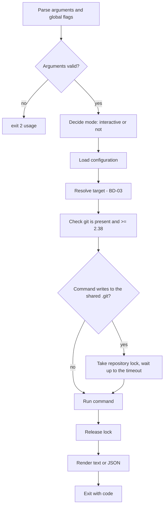

# BD-00 — Shared foundation

## 1. Purpose

Every GitHive command behaves the same way in five areas: whether it may ask questions, what it prints, how it fails, how it calls git, and how it shares a repository with other running commands. This document fixes that common behaviour once, so that BD-01…BD-09 only describe what is specific to their command, and so that an AI agent can drive every command with the same rules.

## 2. Users & use cases

| ID | Actor | Use case |
| --- | --- | --- |
| UC-01 | AI agent | Runs any command with `--json`, reads one JSON object from stdout, and branches on the exit code and the error code. |
| UC-02 | Human in a terminal | Runs a command with a missing argument and is asked for it instead of getting an error. |
| UC-03 | Two agents | Run `spawn` in the same repo at the same moment. The second waits a few seconds for the first, then succeeds. |
| UC-04 | Human or agent | Runs a command on a machine where git is missing or too old, and gets one clear message saying what to install. |
| UC-05 | Script or CI | Runs a command without a terminal; it never hangs waiting for input or for a git password prompt. |
| UC-06 | Human debugging | Adds `--verbose` to see every git command GitHive runs. |

## 3. Commands & user-facing I/O

### 3.1 Global flags (accepted by every command)

| Flag | Meaning |
| --- | --- |
| `--json` | Print exactly one JSON object on stdout (§3.3). Implies non-interactive. |
| `--yes`, `-y` | Never ask. Use defaults where they exist; otherwise fail with exit code 2. Also confirms destructive actions (BR-05). |
| `--verbose`, `-v` | Print each git command and its duration to stderr. |
| `--no-color` | Disable colour. Colour is also off when `NO_COLOR` is set or stdout is not a terminal. |
| `--help`, `-h` | Help for the command. |

`-p/--project` does not exist. The project comes from the target or from the current directory (BD-03).

### 3.2 Human output

- Results go to **stdout**. Warnings, progress and errors go to **stderr**.
- Messages are in English, one line per item, with a short hint when the user can act on them.
- Errors have the form `githive: <message>` followed, when useful, by `hint: <what to do>`.

```
$ githive spawn kirindo@task-18
githive: project "kirindo" has no base branch
hint: githive project config kirindo --base dev
```

### 3.3 JSON output

With `--json`, stdout holds one JSON object and nothing else, for success and for failure alike.

Success:

```json
{
  "ok": true,
  "command": "spawn",
  "data": { "...": "command-specific, defined in each DD" },
  "warnings": [
    { "code": "repo_on_mnt", "message": "repository is under /mnt/c; git is slow there" }
  ]
}
```

Failure:

```json
{
  "ok": false,
  "command": "spawn",
  "error": {
    "code": "base_branch_unset",
    "message": "project \"kirindo\" has no base branch",
    "hint": "githive project config kirindo --base dev",
    "exit_code": 2
  },
  "warnings": []
}
```

`githive version --json` adopts the same envelope; its current bare object (from P02) changes before v0.1.0.

### 3.4 Exit codes and error codes

Exit codes are those of ADR-0002. Each error also carries a stable `error.code` string, so agents can tell apart failures that share an exit code. Initial catalogue (DDs may add codes; never rename or reuse one):

| Exit | `error.code` | When |
| --- | --- | --- |
| 1 | `internal` | Unexpected failure (a bug) |
| 1 | `git_failed` | A git command failed for a reason not covered below; `message` includes git's stderr |
| 1 | `io_failed` | Reading or writing a file or directory failed |
| 2 | `usage` | Unknown command or flag, wrong number of arguments |
| 2 | `input_required` | A value is missing and the command may not ask (BR-02) |
| 2 | `not_configured` | `githive init` has not been run |
| 2 | `base_branch_unset` | The project has no base branch |
| 2 | `invalid_target` | Target does not follow BD-03 |
| 2 | `project_not_found` / `task_not_found` | Target names something that does not exist |
| 2 | `task_exists` / `branch_exists` | `spawn` would overwrite something |
| 2 | `git_missing` / `git_too_old` | git is not on PATH, or older than 2.38 |
| 3 | `sync_conflict` | Sync stopped on a conflict; the worktree is back to its previous state |
| 4 | `unsafe` | A safety check refused the action (dirty, unpushed, locked, main worktree) |
| 5 | `lock_timeout` | Another GitHive command held the repository lock for too long |

## 4. Main flow

Every command runs the same pipeline. Only the "run" step differs.



## 5. Alternate & error flows

| Situation | What the user sees | Exit |
| --- | --- | --- |
| Missing value, interactive | A prompt for the value, with the default pre-filled when there is one | — |
| Missing value, non-interactive | `input_required` naming the flag to pass | 2 |
| Lock held by another command | After 1 s on stderr: `waiting for githive spawn (pid 4312) on kirindo…`; continues as soon as the lock is free | — |
| Lock still held after the timeout | `lock_timeout`, naming the command and pid holding it | 5 |
| git asks for a password in non-interactive mode | git fails at once instead of waiting (BR-07); `git_failed` with git's message | 1 |
| git missing or older than 2.38 | `git_missing` / `git_too_old` with the version found and a link to install git | 2 |
| Repository under `/mnt/*` on WSL | Warning `repo_on_mnt` once per run; the command continues | — |
| User presses Ctrl+C | Lock released, partial work rolled back where the command defines a rollback, message `interrupted` | 130 |

## 6. Business rules

- **BR-01 — Interactive mode.** A command may ask questions only when stdin and stdout are both terminals and neither `--json` nor `--yes` is given.
- **BR-02 — Never hang.** In non-interactive mode a missing value is an error (`input_required`, exit 2) unless the value has a documented default.
- **BR-03 — One channel per purpose.** Results on stdout; everything else on stderr. With `--json`, stdout contains only the JSON object, and warnings travel inside it.
- **BR-04 — Stable contract.** Exit codes, `error.code` values and JSON field names are a public API from v0.1.0 (ADR-0002). New fields and codes may be added; existing ones are never renamed, removed or reused.
- **BR-05 — Destructive actions need a yes.** An action that deletes work (`retire`) asks once in interactive mode and requires `--yes` in non-interactive mode. `--force` (CL-03) skips the safety checks but does not replace `--yes`.
- **BR-06 — git invocation.** Every git call passes an argument list (never a shell string), runs with `LC_ALL=C`, and uses `-C <dir>` instead of changing the process directory.
- **BR-07 — No credential prompts when non-interactive.** In non-interactive mode git runs with `GIT_TERMINAL_PROMPT=0`, so a missing credential fails fast instead of hanging an agent.
- **BR-08 — Minimum git.** git 2.38 or newer is required and checked before the first git call of a run.
- **BR-09 — Repository lock.** Commands that write to the shared `.git` (fetch, worktree add/remove, branch delete, `git config --local`) take the lock in `git rev-parse --git-common-dir` (`githive.lock`), hold it only for those steps, and wait at most 30 s (overridable with `GITHIVE_LOCK_TIMEOUT`, in seconds). Different repositories never wait for each other. Read-only commands never take the lock.
- **BR-10 — Lock holder is visible.** A small file next to the lock (`githive.lock.info`, DD-00) records the holder's command, pid, host and start time, so a waiting command can say who it waits for. The operating system releases the lock when the holder exits, so a crashed command never leaves a lock behind.
- **BR-11 — Paths.** Paths are printed in the native form of the OS (`D:\workspace\…` on Windows, `/home/…` elsewhere) and are absolute in JSON.
- **BR-12 — Interrupt.** On Ctrl+C a command releases the lock, rolls back what its DD defines as rollback, and exits 130.
- **BR-13 — Language.** All CLI output, help and error messages are in English (CL-05).

## 7. Platform constraints

- **Windows:** the lock uses `LockFileEx` (through `gofrs/flock`); the console must print UTF-8; paths are compared case-insensitively; a directory held open by another process cannot be deleted (relevant to `retire`).
- **WSL:** warn when the repository is under `/mnt/*` (BR rule in §5); never mix the WSL and Windows git on one repository (BD-00-overview §4).
- **Linux:** none.
- **macOS:** file systems are case-insensitive by default; file names may come back in Unicode NFD form, so names are compared after normalisation.

## 8. Out of scope

- The interactive menu shown when `githive` runs with no arguments: BD-01 (until then it prints help).
- Log files and telemetry: not planned.
- Localised messages: not planned (BR-13).
- Timeouts for git network operations: not planned (DD-00 §11).

## 9. Open questions

- [x] **Danny:** CLI messages in English only (BR-13)? → Yes (CL-05, 2026-11-13).
- [x] **Advisor:** exit code 130 on interrupt (BR-12) adds a code to the ADR-0002 list. It follows the shell convention (128 + SIGINT), so it is accepted; it is recorded in ADR-0004.
- [x] **Advisor (DD-00):** should `fetch` have its own timeout? → No; rely on git's own network settings (DD-00 §11).

## 10. Traceability

| Requirement | Business rules |
| --- | --- |
| NFR-01 (Windows, WSL, Linux, macOS) | BR-06, BR-11, §7 |
| NFR-02 (parallel agents without conflicts) | BR-09, BR-10, BR-12 |
| NFR-05 (interactive setup instead of typing commands) | BR-01, BR-02, BR-05 |
| ADR-0002 (automation contract) | BR-03, BR-04, BR-07 |

## Revision history

| Date | Change |
| --- | --- |
| 2026-11-13 | In review (P03) |
| 2026-11-13 | Approved (P04): CL-05 answered, lock holder moved to `githive.lock.info`, fetch timeout closed |
