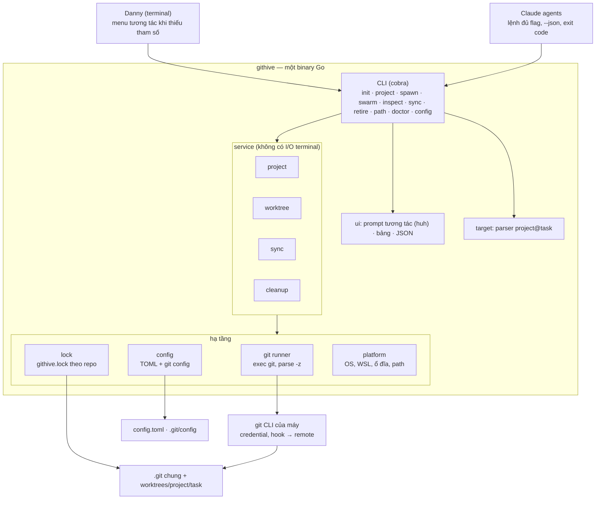

# GitHive — Basic Design tổng thể

Tài liệu này mô tả kiến trúc tổng thể của GitHive, một CLI quản lý git worktree cho nhiều Claude agent chạy song song.

- **Vị trí trong bộ tài liệu:** đây là bản tổng quan. Mỗi chức năng có BD-01…BD-09 (xem [README.md](README.md)) mô tả chi tiết hơn và có thể tinh chỉnh tài liệu này.
- **Thứ tự ưu tiên khi các tài liệu mâu thuẫn:** ADR mới nhất ở trạng thái Approved, rồi đến BD/DD của chức năng ở trạng thái Approved, rồi đến tài liệu này.
- **Thuật ngữ:** "task" là tên một worktree trong một dự án. "Base branch" là nhánh chung mà mọi task được tạo ra từ đó (`dev`, `develop`…).

## 1. Đánh giá requirement

Dùng `git worktree` là đúng hướng cho bài toán "chỉ một agent được checkout": một repo, nhiều thư mục làm việc, mỗi thư mục một nhánh, cùng dùng chung object database. Giá trị của GitHive nằm ở việc **chuẩn hóa quy trình**: luôn tạo task từ commit mới nhất của base branch, đặt tên thống nhất, dọn dẹp an toàn. Bản thân các lệnh git thì không có gì mới.

### Nguyên nhân gốc của vấn đề hiện tại

Một working directory chỉ có một `HEAD` và một index. Khi bốn agent dùng chung một thư mục, lệnh `git checkout` của agent này phá file đang sửa của agent khác. Worktree tách riêng `HEAD`, index và file, nên mỗi agent có sandbox riêng. Git cũng tự cấm checkout một nhánh ở hai worktree cùng lúc, nên quy tắc "mỗi agent một nhánh" được git đảm bảo sẵn.

### Những điểm requirement đúng và nên giữ

- Base branch cấu hình theo từng dự án (`dev`, `developer`, `develop`…) — NFR-03.
- Tên nhánh = tiền tố + tên task (`feat/worktree-18`) — REQ-04, CL-02.
- Có các lệnh liệt kê, sync, xóa hàng loạt, liệt kê dự án — REQ-05…REQ-08.
- Cấu hình được giữ lại khi hết phiên làm việc hoặc khởi động lại máy — NFR-04.

### Những điểm còn thiếu hoặc có rủi ro, và cách GitHive xử lý

| # | Vấn đề | Vì sao quan trọng | Cách xử lý |
| --- | --- | --- | --- |
| 1 | Đường dẫn ví dụ `D:\workspace\worktrees\worktree-18` không có tên dự án | Hai dự án cùng có task `worktree-18` sẽ trùng thư mục | `<worktrees_root>/<project>/<task>` |
| 2 | "Lấy commit mới nhất từ dev" chưa nói rõ lấy ở local hay remote | Nhánh `dev` ở local thường đã cũ; không cần, và không nên, checkout `dev` | `git fetch <remote> <base>` rồi tạo task từ `<remote>/<base>` |
| 3 | Các worktree vẫn dùng chung một số tài nguyên git | Hai agent cùng chạy `fetch` hoặc `worktree add` có thể gặp lỗi `cannot lock ref` | Khóa file theo từng repo, chỉ giữ khóa trong vài giây |
| 4 | Dùng lẫn WSL và Windows | Repo nằm ở `/mnt/d` mà chạy từ WSL thì rất chậm; worktree tạo bằng git của WSL ghi đường dẫn Linux, git của Windows không đọc được | Mỗi repo chỉ thao tác bằng git của một phía; `doctor` cảnh báo |
| 5 | File không được git theo dõi (`.env`, `appsettings.Development.json`) | Worktree mới thiếu các file này, agent build lỗi | Cấu hình `copy_files` và hook `post_create` |
| 6 | Agent cũng là người dùng tool | Wizard hỏi tương tác sẽ làm agent bị treo | Lệnh nào cũng chạy được chỉ bằng flag, có `--json`, exit code rõ ràng |
| 7 | Xóa worktree cho an toàn | Squash merge trên GitLab khiến `git branch --merged` không nhận ra nhánh đã merge | Kiểm tra theo CL-03; nhận diện nhánh đã merge qua việc nhánh remote đã bị xóa |
| 8 | Windows giới hạn đường dẫn 260 ký tự (MAX_PATH) | `node_modules` nằm sâu trong worktree sẽ gặp lỗi | Giữ đường dẫn gốc ngắn, bật `core.longpaths` |
| 9 | Cổng dev server | 4 agent cùng chạy `npm run dev` sẽ tranh nhau cổng 3000 | Ngoài MVP; cân nhắc cấp cổng theo worktree ở v2 |

### Các làm rõ requirement đã chốt

Danny đã chốt các làm rõ này trong P01b; chi tiết xem `docs/requirements/README.md`, mục Clarifications.

| Mã | Nội dung tóm tắt |
| --- | --- |
| CL-01 | Không lưu "dự án hiện tại". Mỗi lệnh xác định dự án qua `project@task` hoặc qua thư mục đang đứng. |
| CL-02 | Tên nhánh mặc định là `<prefix><task>`, prefix cấu hình theo dự án (mặc định `feat/`). `--branch <tên đầy đủ>` đặt tên khác. |
| CL-03 | Không xóa worktree chính, worktree còn thay đổi chưa commit, có commit chưa push hoặc đang bị lock. `--force` bỏ qua các kiểm tra này; trong terminal tương tác thì hỏi xác nhận một lần cho cả danh sách. |
| CL-04 | "workspace" là thư mục chứa các dự án (projects root). "Nhánh chỉ định chính" là base branch dùng để tạo worktree. |

## 2. Định vị sản phẩm

Có hai công cụ đã làm phần việc "tạo worktree cho agent":
- **Claude Code** có sẵn cờ `--worktree` (`-w`) từ bản 2.1.49 (tháng 2/2026). Worktree được tạo trong `.claude/worktrees/` của repo, và file `.worktreeinclude` dùng để chép các file bị gitignore ([docs](https://code.claude.com/docs/en/worktrees)).
- **Worktrunk** là CLI quản lý worktree cho các agent chạy song song ([worktrunk.dev](https://worktrunk.dev)).

GitHive không cạnh tranh ở phần việc đó. GitHive tập trung vào năm điểm khác biệt:

1. **Nhiều dự án:** một workspace chứa nhiều repo; mỗi task được gọi theo dạng `project@task`.
2. **Kỷ luật base branch:** mỗi dự án có base branch riêng. Lần tạo task nào cũng fetch trước và tạo từ `<remote>/<base>`.
3. **Dọn dẹp an toàn theo lô:** `retire` không xóa phần việc chưa commit hoặc chưa push, và nhận ra nhánh đã squash merge.
4. **Windows và WSL được hỗ trợ đầy đủ:** có quy tắc đường dẫn, đường dẫn dài, khóa file và cảnh báo riêng cho WSL.
5. **Không gắn với forge nào:** chạy được với GitLab, GitHub hay remote tự host. API của forge chỉ là phần bổ sung tùy chọn (v2).

Cách dùng khuyến nghị: chạy `githive spawn kirindo@task-18` để tạo worktree, `cd` vào thư mục đó, rồi chạy `claude` như bình thường (không dùng `-w`). V2 có thể thêm `githive spawn kirindo@task-18 --run claude` để mở agent ngay. Trước khi chốt phạm vi cần kiểm tra lại: `claude -w` tạo nhánh từ đâu, và có cấu hình base branch được không.

## 3. Quyết định kiến trúc chính

| Quyết định | Lựa chọn | Lý do | Phương án bị loại |
| --- | --- | --- | --- |
| Ngôn ngữ | **Go** (cobra cho CLI, charmbracelet/huh cho phần hỏi tương tác) | Một file binary duy nhất, cross-compile sẵn cho Windows/Linux/macOS × amd64/arm64, khởi động nhanh, không cần runtime | Node/TS (phải cài Node), Rust (khó học hơn), bash/PowerShell (không có một bản chạy chung cho mọi OS) |
| Tương tác git | Gọi **git CLI** có sẵn trên máy, phân tích output dạng `--porcelain -z` | Dùng đúng credential, hook và config của user; hỗ trợ worktree đầy đủ | go-git (hỗ trợ worktree hạn chế, không dùng được credential helper) |
| Nguồn sự thật về worktree | **`git worktree list`**, tool không tự lưu danh sách | Không bao giờ lệch với thực tế, kể cả khi user hay agent dùng git trực tiếp | File trạng thái hoặc SQLite riêng (dễ lệch) |
| Cấu hình toàn cục | File TOML trong thư mục config chuẩn của OS | Giữ được qua khi tắt máy, user sửa tay được | Biến môi trường (mất khi đóng shell) |
| Cấu hình theo dự án | **`git config --local githive.*`** trong `.git/config` của repo | Cấu hình đi theo repo, xóa repo là xóa luôn cấu hình, mọi worktree cùng đọc chung | Lưu bảng project → config trong file toàn cục (lệch khi đổi tên hoặc di chuyển repo) |
| Đồng thời | File khóa `githive.lock` trong thư mục trả về từ `git rev-parse --git-common-dir`, timeout 30 giây | Ngăn 2 agent cùng fetch/add/remove trên một repo; các repo khác nhau không phải chờ nhau | Không khóa (thỉnh thoảng gặp lỗi `cannot lock ref`) |
| Chế độ chạy | Thiếu tham số và có TTY thì hỏi tương tác; không có TTY hoặc có `--yes` thì báo lỗi rõ ràng | Người dùng thích menu, agent cần lệnh chạy xác định | Chỉ có giao diện TUI |
| Phân phối | GoReleaser tạo bản release; Homebrew tap, Scoop/winget, script `install.sh`. Gói cài thêm `git-hive` để gõ được `git hive <lệnh>` | Cài bằng một lệnh trên mọi OS | — |

Phiên bản git tối thiểu là 2.38, vì cần `git merge-tree --write-tree` để dự đoán conflict. Từ git 2.48 có thêm `worktree.useRelativePaths`, hữu ích khi di chuyển thư mục hoặc dùng lẫn WSL và Windows.

## 4. Quy tắc chọn đường dẫn

Trả lời câu hỏi "ổ D: hay ổ C:": **không chọn theo ổ đĩa, mà luôn đặt worktree ở cùng chỗ với thư mục dự án.** User chọn projects root một lần, và worktrees root mặc định được suy ra từ đó. Nhờ vậy câu hỏi D hay C không còn nữa, và worktree luôn nằm cùng ổ, cùng filesystem với repo: thao tác nhanh, không lỗi hardlink, không lẫn Windows với WSL.

### Thứ tự ưu tiên khi xác định đường dẫn

1. Flag trên lệnh (`--path`).
2. Biến môi trường (`GITHIVE_WORKTREES_ROOT`).
3. Cấu hình theo repo (`githive.worktreesRoot`).
4. Cấu hình toàn cục (`worktrees_root`).
5. Giá trị mặc định: `<projects_root>/worktrees`.

### Gợi ý mặc định trong wizard `githive init`

Wizard luôn hiển thị gợi ý để user xác nhận hoặc sửa.

| Môi trường | Projects root gợi ý | Ghi chú |
| --- | --- | --- |
| Windows có ổ D: cố định, ghi được | `D:\workspace` | Kiểm tra đó là ổ cố định (không phải USB, ổ mạng hay ổ DVD) |
| Windows chỉ có ổ C: | `%USERPROFILE%\workspace` | Không dùng `C:\workspace` ở gốc ổ, vì máy công ty có thể chặn quyền tạo thư mục ở gốc ổ |
| WSL | `~/workspace` (filesystem ext4 của WSL) | **Không** gợi ý `/mnt/d/...`: đọc ghi qua 9P chậm hơn nhiều lần, npm hay dotnet build rất chậm |
| Linux / macOS | `~/workspace` | — |

Cấu trúc thư mục kết quả (ví dụ trên Windows):

```
D:\workspace\
  kirindo\            ← repo chính (có .git)
  crm2\
  worktrees\
    kirindo\
      task-18\        ← kirindo@task-18, nhánh feat/task-18
      task-19\
    crm2\
      fix-login\      ← crm2@fix-login
```

### Quy tắc phụ

- Không đặt worktree bên trong repo chính, vì IDE, `dotnet build` hay `tsc` sẽ quét cả thư mục con.
- Khi quét dự án, bỏ qua thư mục `worktrees` (không coi là một dự án).
- Dự án nằm ngoài projects root được đăng ký bằng `githive project add <path>` và lưu trong cấu hình toàn cục.
- Windows: đường dẫn gốc càng ngắn càng tốt; `doctor` kiểm tra `core.longpaths=true`.
- WSL: nếu repo nằm ở `/mnt/*` thì `doctor` cảnh báo. Mỗi repo chỉ thao tác bằng git của một phía (WSL hoặc Windows), vì file `.git` trong worktree chứa đường dẫn tuyệt đối theo phía đã tạo ra nó.
- Tên task phải khớp `^[a-z0-9][a-z0-9._-]{0,49}$` (không chứa `@` hay `/`) và phải hợp lệ với `git check-ref-format --branch`. Quy tắc chi tiết ở BD-03.

## 5. Kiến trúc tầng & module



Phân chia trách nhiệm giữa các tầng:
- **CLI** chỉ phân tích tham số rồi gọi service.
- **Service** chứa logic nghiệp vụ và không biết gì về terminal.
- **Tầng hạ tầng** là nơi duy nhất làm việc với git, file hệ thống và OS.

Nhờ vậy, service được test bằng các repo git tạm trong thư mục temp, và test chạy giống nhau trên CI Windows, Linux và macOS.

Cấu trúc thư mục (giống `CLAUDE.md` §5):

```
cmd/githive/            main.go
internal/cli/           các lệnh cobra: phân tích flag, gọi service, hiển thị kết quả
internal/ui/            prompt tương tác, bảng, output JSON
internal/service/       project, worktree, sync, cleanup
internal/git/           runner, parser porcelain, status
internal/config/        TOML toàn cục, git config theo repo, thứ tự ưu tiên
internal/lock/          khóa file (flock / LockFileEx)
internal/platform/      đường dẫn, phát hiện WSL, ổ đĩa Windows
internal/target/        parser project@task
internal/testutil/      dựng repo remote và clone tạm cho test
tools/docs-check/       công cụ kiểm tra tài liệu
```

## 6. Mô hình cấu hình & dữ liệu

Có hai tầng cấu hình và không có database riêng. Trạng thái worktree luôn đọc trực tiếp từ git, nên dù xóa hay tạo worktree bằng git trực tiếp, tool vẫn không bị sai.

### Tầng 1 — Cấu hình toàn cục (giữ lại khi tắt máy)

| OS | Vị trí file |
| --- | --- |
| Windows | `%APPDATA%\githive\config.toml` |
| Linux / WSL | `$XDG_CONFIG_HOME/githive/config.toml` (mặc định `~/.config/githive/config.toml`) |
| macOS | `~/.config/githive/config.toml` (quen thuộc với dev hơn `~/Library/Application Support`) |

```toml
version = 1
projects_root  = "D:/workspace"
worktrees_root = "D:/workspace/worktrees"   # để trống = <projects_root>/worktrees
extra_projects = ["E:/legacy/old-app"]      # dự án ngoài projects_root, thêm bằng `githive project add`

[defaults]
remote        = "origin"
branch_prefix = "feat/"
sync_strategy = "rebase"     # rebase | merge | auto (BD-06 chốt giá trị mặc định)
copy_files    = [".env", ".env.local"]
```

Ghi file theo cách atomic (ghi ra file tạm rồi đổi tên) để config không hỏng nếu mất điện giữa chừng. Trường `version` dùng cho việc chuyển đổi định dạng config sau này. Các khóa và giá trị cụ thể sẽ được chốt ở DD-01.

### Tầng 2 — Cấu hình theo dự án (trong `.git/config` của repo)

```ini
[githive]
    baseBranch   = dev          ; chưa set thì hiển thị NULL
    branchPrefix = feat/        ; ghi đè giá trị trong defaults
    syncStrategy = merge
    copyFiles    = .env
    copyFiles    = appsettings.Development.json
    postCreate   = npm ci
```

Cấu hình này được đặt bằng `githive project config kirindo --base dev`; bên dưới tool gọi `git config --local githive.baseBranch dev`. Vì nằm trong `.git/config` dùng chung, mọi worktree của repo đều đọc cùng một giá trị. Nếu team muốn chia sẻ quy ước, có thể commit thêm file `.githive.toml` ở gốc repo, được đọc với mức ưu tiên thấp hơn `.git/config` — để v2. Hook trong file commit chung này chỉ chạy khi user đã đồng ý tin tưởng repo đó.

### Thứ tự áp dụng cấu hình

Flag → biến môi trường `GITHIVE_*` → `.git/config` (`githive.*`) → `.githive.toml` trong repo (v2) → `config.toml` toàn cục → giá trị mặc định của tool.

### Thực thể runtime (không lưu lại, tính mỗi lần chạy)

| Thực thể | Trường chính | Nguồn |
| --- | --- | --- |
| Project | name, path, commonDir, remote, baseBranch (có thể null), worktreeCount | Quét `projects_root` ở độ sâu 1, cộng `extra_projects`, cộng `git config` |
| Worktree (task) | project, task, path, branch, head, isMain, locked, prunable | `git worktree list --porcelain -z` |
| WorktreeStatus | dirty, ahead, behind (so với `<remote>/<base>`), upstreamGone, lastCommitAt, diskSize | `git status --porcelain`, `rev-list --left-right --count`, `for-each-ref` |

## 7. Thiết kế lệnh CLI

Binary tên là `githive`. Gói cài thêm `git-hive`, nên gõ `git hive <lệnh>` cũng được. Có thêm alias ngắn `ghive` hay không là câu hỏi mở, Danny sẽ quyết định.

Mọi lệnh có `--json` và `--yes`. Lệnh nhận task theo cú pháp `project@task`; nếu đang đứng trong repo hoặc worktree của dự án thì chỉ cần `task` (CL-01). Không có flag `-p/--project`: dự án được xác định qua target hoặc qua thư mục đang đứng (BD-03, P03-D1). Gõ `githive` không kèm tham số sẽ in help, cho tới khi DD-01 thiết kế menu tương tác (P01d-D3).

| Lệnh | Alias | Requirement | Mô tả |
| --- | --- | --- | --- |
| `githive init` | | REQ-01, REQ-02, NFR-04, NFR-05 | Wizard thiết lập projects root, worktrees root, prefix, chiến lược sync. Chạy lại để sửa |
| `githive config get/set <key>` | | NFR-04 | Xem và sửa config toàn cục mà không phải mở file |
| `githive project add <path>` | `hive add` | REQ-03 | Đăng ký dự án nằm ngoài projects root. Repo trong projects root được tự phát hiện |
| `githive project list` | `hive list` | REQ-08 | Bảng gồm tên dự án, base branch (hoặc `NULL`), số task, đường dẫn (UI spec §9) |
| `githive project config <p> --base dev [--prefix feat/] [--sync merge]` | `hive config` | REQ-03, REQ-08, NFR-03 | Đặt cấu hình theo dự án. Không truyền `--base` thì tool gợi ý từ `origin/HEAD` và các nhánh `dev`/`develop`/`developer` có trên remote |
| `githive spawn <project@task> [--base x] [--branch <tên đầy đủ>] [--no-hooks]` | `new`, `create` | REQ-04, NFR-02, CL-02 | Fetch base, tạo worktree và nhánh `<prefix><task>`, chép file, chạy hook, in đường dẫn |
| `githive spawn <project@task> --from-remote <branch>` | | — | Mở worktree cho một nhánh đã có trên remote (ví dụ để review MR của người khác) |
| `githive swarm ['project@*' \| --all]` | `ls`, `list` | REQ-05 | Liệt kê worktree: task, nhánh, ahead/behind so với base, dirty, lần commit cuối |
| `githive inspect <project@task>` | | REQ-05 | Trạng thái chi tiết của một worktree |
| `githive sync <project@task> [--rebase\|--merge] [--dry-run] [--autostash]` | | REQ-06 | Fetch base, dự đoán conflict, rồi rebase hoặc merge |
| `githive retire <project@task...> \| 'project@*' [--merged] [--stale 14d] [-i] [--force]` | `rm`, `remove` | REQ-07, CL-03 | Xóa worktree và nhánh local, có kiểm tra an toàn |
| `githive path <project@task>` | | — | In đường dẫn, dùng như `cd $(githive path kirindo@task-18)`. `githive shell-init` sinh hàm shell để `cd` nhanh; tên hàm chốt ở BD-08 |
| `githive doctor` | | NFR-01 | Kiểm tra phiên bản git, `core.longpaths`, repo nằm trên `/mnt/*`, worktree mồ côi (`git worktree prune`) |

`project@*` phải đặt trong dấu nháy để shell không tự mở rộng dấu `*`. Cú pháp không bao giờ bắt đầu bằng `@`, vì PowerShell hiểu `@` ở đầu là splatting.

### Exit code (để agent xử lý theo từng trường hợp)

| Code | Ý nghĩa |
| --- | --- |
| 0 | Thành công |
| 1 | Lỗi chung |
| 2 | Sai tham số hoặc thiếu cấu hình (ví dụ base branch là NULL) |
| 3 | Conflict khi sync (đã abort, worktree giữ nguyên) |
| 4 | Bị chặn vì kiểm tra an toàn (thay đổi chưa commit, commit chưa push…) |
| 5 | Hết thời gian chờ khóa |

Từ v0.1.0, exit code và schema của `--json` được coi là API công khai: thay đổi phải được Danny duyệt.

Màn hình, bảng và thông báo cụ thể theo `docs/product/ui-spec.md`; các ví dụ output trong tài liệu này chỉ để minh họa.

Ví dụ output của `githive swarm 'kirindo@*'`:

```
PROJECT kirindo   BASE origin/dev
TASK          BRANCH              ↑AHEAD ↓BEHIND  STATE   LAST COMMIT
task-18       feat/task-18        3      12      dirty   2h ago
task-19       feat/task-19        0      0       clean   5m ago
fix-otp       feat/fix-otp        5      40      gone    9d ago   ← nhánh remote đã xóa, có thể retire
```

## 8. Luồng xử lý chính

Nguyên tắc chung: khóa chỉ bao quanh các thao tác ghi vào `.git` dùng chung (fetch, thêm hoặc xóa worktree, xóa nhánh) và chỉ giữ vài giây. Agent làm việc trong worktree của mình không bao giờ phải chờ khóa.

### 8.1 `githive spawn kirindo@task-18`

1. Phân tích target và kiểm tra tên (BD-03). Tính `branch = <prefix>task-18` (hoặc giá trị của `--branch`) và `path = <worktrees_root>/kirindo/task-18`.
2. Đọc `githive.baseBranch`. Nếu là NULL: có TTY thì hỏi (kèm gợi ý từ remote) rồi lưu lại; không có TTY thì thoát với code 2.
3. Kiểm tra: đường dẫn chưa tồn tại, nhánh chưa có ở local (`git show-ref`), và chưa có trên remote (kiểm tra sau khi fetch).
4. **Lấy khóa** của repo.
5. `git fetch <remote> <base> --prune` để cập nhật `<remote>/<base>` mới nhất.
6. `git worktree add --no-track -b <branch> <path> <remote>/<base>`: tạo thẳng từ remote, không đụng tới nhánh base ở local. Dùng `--no-track` để upstream không trỏ vào base, tránh lỡ tay push lên base.
7. **Nhả khóa.**
8. Chép các file trong `copy_files` từ repo chính sang (bỏ qua file không tồn tại, không ghi đè file đã có).
9. Chạy `postCreate` trong worktree mới. Hook lỗi thì chỉ cảnh báo, không xóa worktree.
10. In đường dẫn (hoặc JSON). Lần push đầu tiên dùng `git push -u <remote> <branch>`.

Rollback: nếu bước 6 lỗi giữa chừng thì chạy `git worktree remove --force` và xóa nhánh vừa tạo.

### 8.2 `githive sync kirindo@task-18` (v1)

1. Worktree còn thay đổi chưa commit thì dừng với code 4, trừ khi có `--autostash`.
2. Lấy khóa → `git fetch <remote> <base>` → nhả khóa.
3. `git rev-list --left-right --count <remote>/<base>...HEAD`; nếu behind = 0 thì xong.
4. Dự đoán conflict bằng `git merge-tree --write-tree <remote>/<base> HEAD`: không đụng vào file, chỉ trả về danh sách file sẽ conflict.
5. Nếu có conflict: in danh sách, rồi hỏi có tiếp tục không (khi có TTY) hoặc thoát với code 3. `--dry-run` luôn dừng ở bước này.
6. Thực hiện `git rebase <remote>/<base>` hoặc `git merge <remote>/<base>`.
7. Nếu gặp conflict thật: mặc định chạy `--abort` để trả về trạng thái cũ và báo code 3; `--keep-conflicts` giữ nguyên conflict để người hoặc agent tự giải quyết.
8. Nếu đã rebase một nhánh đã push: nhắc dùng `git push --force-with-lease`. Tool không tự force push.

### 8.3 `githive retire` (một hoặc nhiều worktree)

1. Xác định danh sách: theo tên, `'project@*'`, `--merged`, `--stale <ngày>`, hoặc chọn nhiều mục trong chế độ `-i`. `--merged`, `--stale` và `-i` thuộc v1.
2. Kiểm tra từng worktree theo CL-03: không phải worktree chính, không có thay đổi chưa commit, không có commit chưa push, không bị `git worktree lock`. Trên Windows, kiểm tra thêm là không có process nào đang mở thư mục đó, vì Windows sẽ không cho xóa.
3. Xác định "đã merge" theo thứ tự: `git merge-base --is-ancestor` (cho merge thường), rồi đến việc nhánh remote đã bị xóa sau `fetch --prune` (GitLab xóa nhánh sau khi squash merge), rồi ở v2 là hỏi trạng thái MR qua API của forge.
4. Hiển thị bảng tổng hợp (task, lý do được xóa hoặc bị chặn, dung lượng sẽ giải phóng) và hỏi xác nhận một lần cho cả danh sách.
5. Lấy khóa → `git worktree remove <path>` → `git branch -d` (hoặc `-D` khi có `--force`) → `git worktree prune` → nhả khóa.
6. Nếu thư mục của dự án trong `worktrees/` đã rỗng thì xóa luôn.

### 8.4 `githive project list`

1. Liệt kê các thư mục con cấp 1 của `projects_root` (bỏ qua `worktrees`), cộng thêm các dự án trong `extra_projects`.
2. Chỉ giữ thư mục có `.git` (là thư mục hoặc là file).
3. Với mỗi repo, đọc song song: `githive.baseBranch` (NULL nếu trống), số worktree, remote URL.
4. In bảng. Lệnh này không fetch, để chạy nhanh và dùng được cả khi offline.

## 9. Rebase hay merge khi sync với base

Khuyến nghị: **rebase khi nhánh chưa push hoặc chưa mở MR; merge khi MR đã mở và đang được review**, trừ khi team chấp nhận force push lên nhánh feature. Tool có thể tự chọn theo quy tắc này (`sync_strategy = auto`); giá trị mặc định chốt ở BD-06.

| Tiêu chí | Rebase | Merge |
| --- | --- | --- |
| Lịch sử | Thẳng, dễ review từng commit | Có thêm merge commit "Merge origin/dev into…" |
| Nhánh đã push | Phải `push --force-with-lease`; reviewer mất dấu comment trên các commit cũ | Push bình thường |
| Nhiều commit và có conflict | Giải conflict **lần lượt cho từng commit** (10 commit cùng sửa một file có thể phải giải 10 lần) | Giải **một lần** |
| Agent tự giải conflict | Khó hơn, nhiều vòng | Dễ hơn |
| GitLab squash merge | Không ảnh hưởng, vì cuối cùng cũng squash | Merge commit biến mất khi squash |

Về lo ngại "worktree có nhiều commit có thể gây xung đột":

- Luôn dự đoán bằng `merge-tree` trước (bước 4 ở mục 8.2). User hoặc agent biết trước file nào sẽ conflict mà worktree không bị đụng tới.
- Nhánh có nhiều commit mà lại có conflict: đề xuất merge, hoặc squash ở local trước rồi mới rebase (`git reset --soft $(git merge-base <remote>/<base> HEAD)` rồi commit lại). Chỉ làm khi user đồng ý.
- Bật `git config rerere.enabled true` cho repo: git nhớ cách đã giải một conflict và tự áp dụng lại khi gặp lại conflict đó.
- Sync sớm và thường xuyên giúp giảm conflict hơn bất kỳ chiến lược nào. `githive swarm` hiện số BEHIND lớn bằng màu cảnh báo để nhắc việc này.
- Không sync một worktree khi agent đang chạy trong đó, vì file sẽ bị thay đổi ngay dưới tay agent. MVP dựa vào kỷ luật của người dùng; v2 có thể đánh dấu worktree đang bận bằng `git worktree lock --reason agent`.

## 10. Tích hợp agent, rủi ro, roadmap, câu hỏi mở

### Tích hợp với Claude agent

- Mỗi agent một worktree, và `claude` được khởi động từ trong thư mục worktree đó.
- Thêm các quy tắc sau vào `CLAUDE.md` của dự án: không `git checkout` hay `git switch` sang nhánh khác, không sửa file nằm ngoài worktree, chạy `githive sync --dry-run` trước khi sync, không force push.
- Ở v2, `githive agent-rules` có thể in sẵn đoạn quy tắc này.

### Rủi ro

| Rủi ro | Mức | Giảm thiểu |
| --- | --- | --- |
| Dùng cả git của WSL và git của Windows trên cùng một repo | Cao | `doctor` cảnh báo; tài liệu ghi rõ "mỗi repo chỉ dùng git của một phía" |
| Xóa nhầm worktree còn việc dở | Cao | Kiểm tra theo CL-03, hiện bảng để xác nhận, chỉ bỏ qua khi có `--force` |
| Windows không xóa được thư mục vì IDE hoặc process đang giữ file | Trung bình | Báo rõ file nào đang bị giữ, cho chạy lại; `prune` dọn phần metadata |
| Tốn dung lượng (`node_modules`, `bin/obj` nhân với số worktree) | Trung bình | `retire` hiện dung lượng sẽ giải phóng (CL-08), `retire --stale` (v1); v2 cân nhắc dùng chung pnpm store |
| Claude Code `-w` hoặc Worktrunk bổ sung tính năng trùng với GitHive | Thấp | Giữ trọng tâm vào năm điểm khác biệt ở mục 2 |

### Roadmap

| Giai đoạn | Phạm vi |
| --- | --- |
| MVP | `init`, `config`, `project add/list/config`, `spawn` (gồm `copy_files` và `postCreate`), `swarm`, `inspect`, `retire <targets>` với kiểm tra an toàn theo CL-03, `path`, `doctor` bản tối thiểu, `--json` và exit code, khóa theo repo, cấu hình hai tầng |
| v1 | `sync` có dự đoán conflict, `retire --merged/--stale/-i`, nhận diện nhánh đã squash merge, `shell-init`, phát hành bằng GoReleaser kèm winget, Scoop, Homebrew, script cài đặt và alias `git-hive` |
| v2 | API của forge (trạng thái MR, tạo MR), `--run claude`, đánh dấu worktree đang bận, cấp cổng theo worktree, `.githive.toml` dùng chung cho team, `agent-rules`, dashboard TUI |

Phạm vi MVP ở đây khớp với danh mục BD trong [README.md](README.md). Thứ tự làm cụ thể theo `docs/PROGRESS.md`.

### Câu hỏi mở

- [ ] GitLab của công ty dùng squash merge hay merge commit? Có tự xóa nhánh nguồn sau khi merge không? (Quyết định cách nhận biết nhánh "đã merge" — BD-07.)
- [ ] Team có cho force push lên nhánh `feat/*` không? (Quyết định giá trị mặc định của `sync_strategy` — BD-06.)
- [ ] Có thêm alias ngắn `ghive` không? (Danny quyết định.)
- [ ] `claude --worktree` hiện tạo nhánh từ đâu, và có cấu hình base branch được không? (Cần thử trước khi chốt BD-04.)
- [x] Chạy trên WSL hay Windows? → Cả hai: máy cá nhân dùng Windows, máy công ty dùng WSL; cả hai được hỗ trợ đầy đủ (NFR-01).
- [x] Có cần prefix khác `feat/` không? → Prefix cấu hình theo dự án, và `--branch` để đặt tên khác (CL-02).

### Lịch sử chỉnh sửa

| Ngày | Thay đổi |
| --- | --- |
| 2026-11-12 | Bản đầu, tên tạm `wtx` (viết trên claude.ai, export sang Markdown ở P01) |
| 2026-11-13 | Bản 2 (P01c): đổi tên thành GitHive và các lệnh spawn/swarm/inspect/retire, cú pháp `project@task`, `project add` và `extra_projects`, thêm CL-01…04, thêm Worktrunk vào phần định vị, vẽ lại sơ đồ bằng Mermaid, đổi tham chiếu requirement sang mã REQ, cập nhật phạm vi MVP/v1/v2 và câu hỏi mở |
| 2026-11-13 | Bản 3 (P03): bỏ `-p/--project` (P03-D1); `swarm` nhận `'project@*'` hoặc `--all` (ADR-0003); gõ `githive` không tham số in help (P01d-D3) |
| 2026-11-14 | Bản 4 (PO-02b): khớp với UI spec — project list, dung lượng ở retire, kênh phát hành v1 |

### Nguồn

- [Claude Code docs — Worktrees](https://code.claude.com/docs/en/worktrees)
- [Worktrunk](https://worktrunk.dev)
