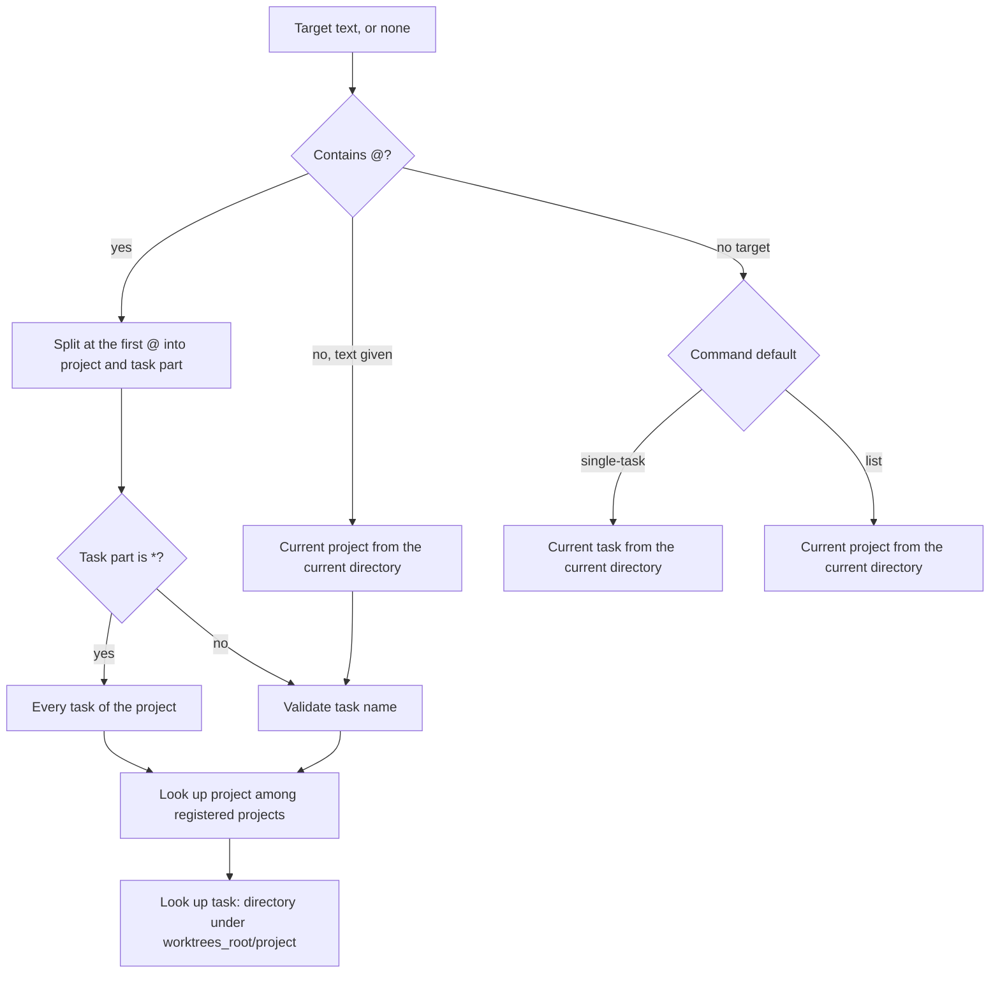

# BD-03 — Target grammar

## 1. Purpose

Users and agents name what a command acts on with a **target**: which project and which task. This document fixes the one way to write a target, how GitHive finds the project and task it points to, and what happens when it cannot. Every command that acts on a worktree uses these rules. It replaces the former `-p/--project` flag (removed, P03-D1).

## 2. Users & use cases

| ID | Actor | Use case |
| --- | --- | --- |
| UC-01 | Agent or human anywhere | `githive spawn kirindo@task-18` — names project and task explicitly. |
| UC-02 | Agent inside its worktree | `githive sync` with no target — acts on the task it is standing in. |
| UC-03 | Human inside the main repo | `githive spawn task-19` — the project comes from the current directory. |
| UC-04 | Human | `githive retire 'kirindo@*' --merged` — every task of one project. |
| UC-05 | Human | `githive swarm --all` — every project (ADR-0003). |

## 3. Commands & user-facing I/O

### 3.1 Forms

| Form | Meaning | Example |
| --- | --- | --- |
| `project@task` | One task of a named project | `kirindo@task-18` |
| `task` | One task of the **current project** (BR-06) | `task-18` |
| `project@*` | Every task of a named project; must be quoted in POSIX shells | `'kirindo@*'` |
| *(no target)* | The **current task** for single-task commands, or the **current project** for list commands (BR-07) | `githive swarm` |

`--all` is not a target: it is a flag of `swarm` meaning every registered project (ADR-0003).

### 3.2 Which commands accept which forms

| Command | `project@task` | `task` | `project@*` | No target | Several targets |
| --- | --- | --- | --- | --- | --- |
| `spawn` | yes | yes | no | no (task is required) | no |
| `inspect`, `path` | yes | yes | no | current task | no |
| `sync` | yes | yes | yes | current task | yes |
| `retire` | yes | yes | yes | no (always explicit) | yes |
| `swarm` | — | — | yes | current project | no |

`retire` never acts on an implicit target, because it deletes work.

### 3.3 Names

| Part | Rule | Examples |
| --- | --- | --- |
| Task | `^[a-z0-9][a-z0-9._-]{0,49}$`, valid for `git check-ref-format --branch` once the prefix is added; must not end in `.lock` or `.`, must not contain `..` | `task-18`, `fix-otp`, `api-m018`, `v2.1-hotfix` |
| Project | The repository's directory name, or the name given at `project add --name`; letters, digits, `.`, `_`, `-`; no `@`, `/`, `\`, spaces; unique among registered projects, compared case-insensitively | `kirindo`, `crm2`, `Kirindo` (same as `kirindo`) |

A project whose directory name breaks the rule (for example `CRM 2`) is still discovered, but can only be targeted after `githive project add <path> --name crm2`.

### 3.4 Output

Commands echo the resolved target in their output. In JSON every result that concerns a task carries:

```json
{ "project": "kirindo", "task": "task-18", "target": "kirindo@task-18" }
```

Errors, for example:

```
$ githive spawn kirindo@Task_18
githive: invalid task name "Task_18": use lowercase letters, digits, ".", "_" or "-"
hint: githive spawn kirindo@task_18
```

```
$ githive sync kirndo@task-18
githive: project "kirndo" not found
hint: did you mean "kirindo"? Registered projects: githive project list
```

## 4. Main flow



"Current directory" resolution: run `git rev-parse --git-common-dir` in the current directory and match it against the registered projects. If the current directory is inside one of the project's worktrees under `worktrees_root/<project>/`, that worktree is the current task.

## 5. Alternate & error flows

| Situation | Error code | Exit |
| --- | --- | --- |
| Empty project or task part (`@task-18`, `kirindo@`) | `invalid_target` | 2 |
| More than one `@` | `invalid_target` | 2 |
| Task name breaks §3.3 | `invalid_target`, with a corrected suggestion when one is obvious (lowercase, `_` kept, spaces → `-`) | 2 |
| `project@*` given to a command that does not accept it | `invalid_target`, listing the accepted forms | 2 |
| `task` alone or no target, but the current directory is not in any registered project | `input_required` in non-interactive mode; in interactive mode, ask which project (pick from the registered projects) | 2 |
| No target for a single-task command, current directory is the main repo, not a task worktree | `input_required` (non-interactive) or ask which task (interactive) | 2 |
| Project not registered | `project_not_found`, with up to three closest names | 2 |
| Task does not exist (any command except `spawn`) | `task_not_found`, with up to three closest names in that project | 2 |
| `project@*` matches no task | Not an error: empty result, exit 0 (`retire` and `sync` say "nothing to do") | 0 |
| Shell expanded `kirindo@*` before GitHive saw it | Cannot be detected reliably; the help text and the error for unknown arguments remind users to quote it | — |

## 6. Business rules

- **BR-01 — One grammar.** A target is `project@task`, `task` or `project@*`. No other spelling exists; there is no `-p/--project` flag (P03-D1).
- **BR-02 — Split once.** The text is split at the first `@`. A second `@` makes the target invalid.
- **BR-03 — No leading `@`.** A target never starts with `@` (PowerShell splatting, ADR-0002).
- **BR-04 — Task names** follow §3.3 and are lowercase (CL-06). GitHive never changes a name silently; it only suggests a corrected one.
- **BR-05 — Project names** are matched case-insensitively and shown as registered. Two registered projects may not differ only in case.
- **BR-06 — Current project.** A bare `task` and an omitted target use the project of the current directory, found through `git rev-parse --git-common-dir` (CL-01). GitHive never stores a "current project".
- **BR-07 — Defaults when no target is given.** Single-task commands (`inspect`, `path`, `sync`) use the worktree the user is standing in. `swarm` uses the current project. `spawn` and `retire` always require an explicit target.
- **BR-08 — The task is the worktree directory.** A task is identified by its directory `<worktrees_root>/<project>/<task>`, not by its branch name, because `--branch` (CL-02) can give it any branch name.
- **BR-09 — Worktrees outside `worktrees_root`.** Worktrees created by hand elsewhere are shown by `swarm` as `external`, but cannot be targeted in the MVP.
- **BR-10 — Several targets.** Where several targets are allowed, they are separated by spaces, may mix projects, and duplicates are dropped. Results keep the order given.
- **BR-11 — Wildcard quoting.** `project@*` is documented with quotes. PowerShell and cmd.exe do not expand `*` for external programs, so quotes are only needed in POSIX shells, but the docs always show them.

## 7. Platform constraints

- **Windows:** comparing paths to find the current project is case-insensitive; `\` and `/` are both accepted in the current directory path.
- **WSL:** a Windows-side path (`/mnt/d/...`) and a WSL-side path to the same repository are different projects; `doctor` warns (BD-09).
- **macOS:** directory names are compared after Unicode normalisation (BD-00 §7).
- **Linux:** none.

## 8. Out of scope

- Targeting worktrees outside `worktrees_root` (BR-09): later version if needed.
- Patterns other than `*` (for example `kirindo@fix-*`): not planned for the MVP.

## 9. Open questions

- [x] **Danny:** is lowercase-only for task names acceptable? → Yes (CL-06, 2026-11-13); `--branch` (CL-02) can still give the branch any name, including upper case.
- [ ] **Advisor (BD-02):** exact flag name for `project add --name`, and whether it can rename a discovered project.

## 10. Traceability

| Requirement | Business rules |
| --- | --- |
| REQ-03 (choose the project) | BR-01, BR-05, BR-06 (CL-01) |
| REQ-04 (name a worktree and its branch) | BR-04, BR-08 (CL-02, CL-06) |
| REQ-05 (list worktrees of a project) | BR-07, BR-09; `swarm --all` per ADR-0003 |
| REQ-07 (remove several worktrees) | BR-07 (`retire` always explicit), BR-10 |

## Revision history

| Date | Change |
| --- | --- |
| 2026-11-13 | In review (P03) |
| 2026-11-13 | Approved (P04): CL-06 answered; §3.4 example suggestion corrected to `task_18` (BR-04 keeps `_`) |
| 2026-11-13 | Rev 2 (P04b): interactive picking of a project or task belongs to target resolution (DD-03), not to the BD-01 menu; removed the contradicting line from §8 |
